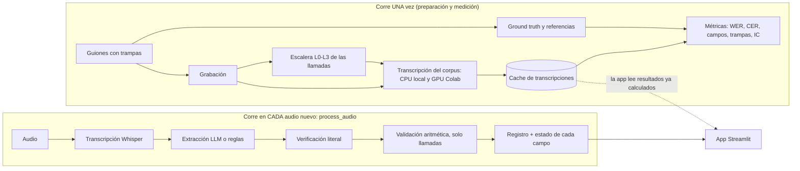
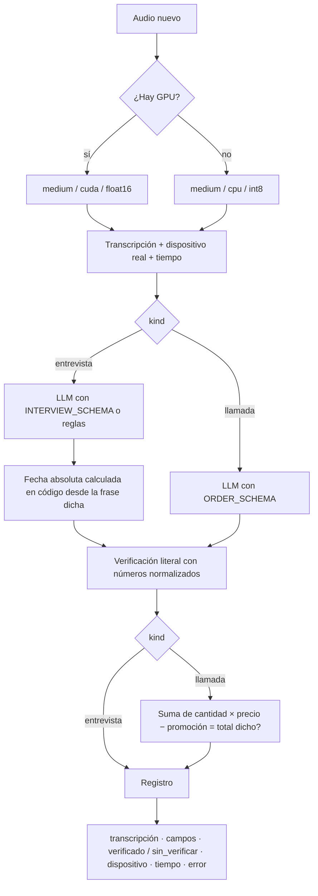

# Pipeline · De la voz al registro

Dos tareas, un solo motor. La **Tarea 1** convierte una entrevista de trabajo grabada en una ficha de
candidato con seis campos. La **Tarea 2** convierte una llamada de venta de un restaurante en un pedido
que se verifica a sí mismo: la suma de los ítems tiene que dar el total dicho.

## Vista general

## Lo que corre una vez

| # | Paso | Herramienta | Resultado |
|---|---|---|---|
| 1 | Escribir 5 guiones de entrevista y 5 de llamada, con trampas a propósito | `docs/guiones/` | Cada campo dicho de forma poco limpia; 3 autocorrecciones, 3 totales mal sumados, 5 direcciones con dígitos |
| 2 | Grabar los 10 audios (2 a 4 min) | Celular | `data/audio/` (no se sube al repo) |
| 3 | Ground truth y transcripciones de referencia | `data/ground_truth/`, `scripts/make_references.py` | Salen del guion: no cuestan nada |
| 4 | Corregir las referencias contra lo que se dijo de verdad | `scripts/diff_references.py` | Donde dos modelos distintos coinciden en apartarse del guion, se dijo otra cosa |
| 5 | Escalera de degradación de las llamadas | `scripts/degrade.py` | L0 original, L1 WhatsApp, L2 teléfono, L3 ruido a 10 dB medido |
| 6 | Transcribir el corpus con el grid modelo × dispositivo × precisión | `scripts/transcribe.py`, `notebooks/colab_gpu.ipynb` | CPU local (i5-6200U) y GPU Colab (Tesla T4); cache en `cache/transcripts/` |
| 7 | Glosario de dominio: sin glosario, `hotwords`, `initial_prompt` | `scripts/glossary.py` | Acierto de términos y WER con IC |
| 8 | Extraer y puntuar las entrevistas (reglas y LLM) | `scripts/extract_interviews.py` | Acierto por campo, `sin_verificar` |
| 9 | Extraer, validar y puntuar las llamadas en cada nivel | `scripts/validate_calls.py` | Trampas detectadas / no detectadas, error ASR vs. hablante |
| 10 | Intervalos de confianza y WER contra registro | `scripts/report.py` | `results/*_ci.csv`, `wer_vs_record.csv` |

## Lo que corre en cada audio nuevo

Una sola función, `engine.pipeline.process_audio(ruta, kind)`, sirve a las dos tareas. Solo cambia el
extractor y su esquema.

1. **Transcripción:** Whisper (`faster-whisper`). Se guarda el dispositivo que reporta el runtime, no
   el de la configuración: así se prueba que se usó la GPU.
2. **Extracción:** LLM local (`qwen2.5:3b` en Ollama) con la salida restringida a un JSON Schema; o
   reglas con expresiones regulares, para comparar.
3. **Verificación:** cada valor tiene que aparecer literal en la transcripción. «seis mil quinientos» y
   6500 se comparan después de normalizar los números. Si no aparece, el campo queda `sin_verificar`.
4. **Validación (solo llamadas):** se cruzan los campos entre sí. Si el total no cuadra, el sistema
   encontró un problema sin necesitar ground truth.

## Decisiones y lo que se descartó

| Paso | Decisión | Por qué | Descartado |
|---|---|---|---|
| Ground truth | Escribirlo antes de grabar, desde el guion | Sale gratis y es humano | Subtítulos de YouTube u otro ASR: mediría parecido entre modelos, no exactitud |
| Referencias | Corregirlas donde dos modelos coinciden contra el guion | Al grabar no se lee palabra por palabra | Usar el guion tal cual (inflaba el WER) o transcribir todo a mano (no da el tiempo). Sesgo declarado: favorece a los modelos usados |
| Modelo ASR | Whisper small y medium | Soportan español y caben en una T4 | Large: en el CPU local sería inviable (medium ya tarda 8–14 min por entrevista) y medium ya da 1–4 % de WER |
| GPU | Colab T4 para las combinaciones cuda | El equipo local no tiene GPU NVIDIA | Confiar en la configuración: el fallback a CPU es silencioso |
| Precisión | Producción: medium int8_float16 en GPU, small int8 en CPU | Mismo WER que float, la mitad de tiempo en CPU | float32 en CPU: 13.6 min por entrevista |
| Glosario | `initial_prompt` | Recupera 3 de 4 tecnologías sin subir el WER | `hotwords`: recupera 4 de 4 pero borró una oración en una entrevista |
| Extracción | LLM local y gratuito con JSON Schema | 87 % contra 27 % de las reglas; sin API key; los datos no salen del equipo | API de pago (queda como opción en `config.yaml`) |
| Fechas | El LLM copia la frase y el código calcula la fecha | El modelo de 3B fallaba la aritmética de calendario | Pedir la fecha directamente al LLM |
| Verificación | Evidencia literal obligatoria | Un modelo que corrige en silencio es tan peligroso como uno que inventa | Aceptar lo que el LLM devuelve |
| SNR de L3 | 10 dB, medido sobre el audio generado | Llamada desde la calle: se entiende pero el ruido está siempre | 20 dB (Whisper casi no lo nota) y 5 dB (ya no es una llamada normal) |
| Error ASR vs. hablante | Comparar el total dicho entre niveles | Un error del hablante se transcribe igual en todos; uno del ASR cambia | Diarización (requiere token y aceptar términos) |
| App | Lee resultados ya calculados | No re-transcribe al abrir | Transcribir al iniciar |

## Qué no debe hacer este sistema

- Decidir solo sobre un candidato o un pedido: un campo `sin_verificar` necesita revisión humana.
- Usarse con audios de personas que no consintieron la grabación.
- Darse por bueno mirando solo el WER: el registro puede fallar con WER bajo.
